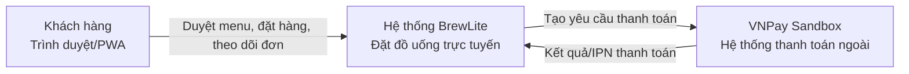
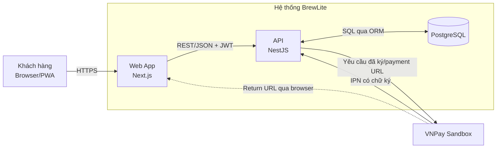
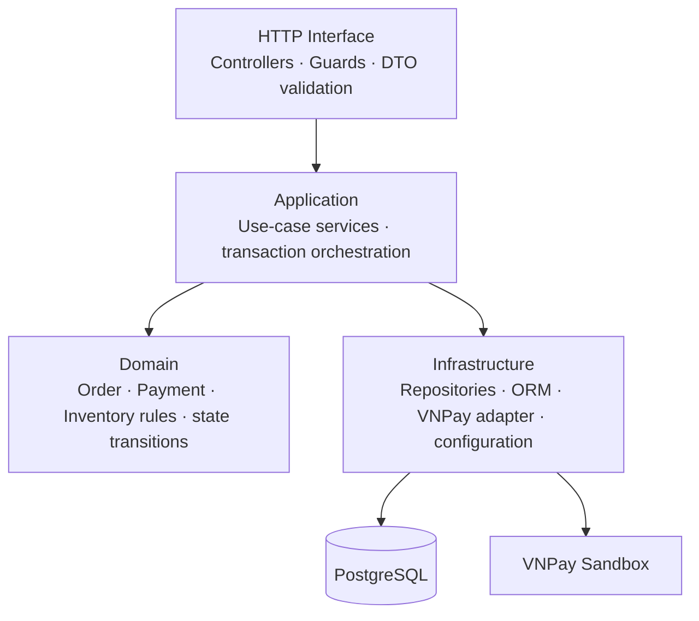

# Kiến trúc BrewLite (Task 3.1)

**Trạng thái:** Kiến trúc mục tiêu cho MVP; chưa phải mô tả hệ thống đã triển khai. 
**Phạm vi:** Web đặt đồ uống, API nghiệp vụ, PostgreSQL và VNPay Sandbox. 
**Nguồn quyết định:** README, SRS, đặc tả checkout, sơ đồ Task 2 và ADR trong thư mục này.

## 1. Bối cảnh và ranh giới hệ thống (C4 – Level 1)

Khách hàng dùng trình duyệt trên điện thoại hoặc máy tính để duyệt menu, tạo đơn và thanh toán. BrewLite cung cấp giao diện web, REST API và lưu dữ liệu nghiệp vụ trong PostgreSQL. VNPay Sandbox là hệ thống ngoài; không có giao dịch production trong phạm vi MVP.

Return URL chỉ đưa khách hàng về BrewLite. API xác minh IPN và đối chiếu mã tham chiếu, số tiền, đơn hàng, chữ ký trước khi ghi nhận kết quả thanh toán.

## 2. Các container (C4 – Level 2)

| Container | Công nghệ mục tiêu | Trách nhiệm |
|---|---|---|
| Web | Next.js, TypeScript, PWA/mobile-first | Hiển thị menu, sản phẩm, giỏ, checkout, trạng thái/lịch sử đơn; gọi API và hiển thị trạng thái nghiệp vụ. |
| API | NestJS, TypeScript, REST/JSON | Xác thực JWT, validate DTO, tính lại giá, quản lý đơn/tồn kho, điều phối thanh toán, nhận và xác minh IPN. |
| Database | PostgreSQL | Lưu user, product, order, order item, payment attempt, promotion và loyalty transaction theo domain model. |
| VNPay adapter | Module nội bộ trong API | Tạo yêu cầu/URL VNPay, ký dữ liệu, xác minh IPN, chuẩn hóa kết quả nhà cung cấp. Không lưu secret ở Web. |

Web và API là hai ứng dụng độc lập trong cùng monorepo; API và Web không truy cập trực tiếp cơ sở dữ liệu của nhau. API là nơi duy nhất thực hiện truy vấn nghiệp vụ đến PostgreSQL.

## 3. Phân lớp API

- **HTTP interface:** nhận request, xác thực JWT, kiểm tra input, gọi application service và ánh xạ lỗi sang HTTP response.
- **Application:** điều phối use-case như tạo đơn, thử lại thanh toán, xử lý IPN; xác định ranh giới transaction.
- **Domain:** giữ quy tắc trạng thái đơn/thanh toán, quyền sở hữu đơn, kiểm tra giá và tồn kho; không phụ thuộc NestJS hoặc VNPay SDK.
- **Infrastructure:** triển khai repository bằng ORM, kết nối PostgreSQL, ký/xác minh thông điệp VNPay, đọc cấu hình từ môi trường.

Luồng tạo đơn cần kiểm tra/giữ tồn kho và ghi Order/OrderItems trong một transaction. Không giữ transaction DB mở trong lúc chuyển khách sang VNPay. IPN hợp lệ cập nhật Payment và Order theo cách idempotent; IPN thất bại đã xác minh hoàn tồn kho đúng một lần. Khi retry sau thất bại, giữ tồn kho lại trước khi tạo payment attempt mới.

## 4. Luồng thanh toán

1. Web gửi `POST /orders`; API xác thực JWT, kiểm tra giỏ, tính lại giá và giữ tồn kho trong transaction.
2. API lưu Order `PENDING`, trả `orderId`, `orderCode`, `totalAmount`.
3. Web gửi `POST /payments` với `orderId`, `paymentMethod: VNPAY` và `Idempotency-Key`.
4. API lấy số tiền từ Order đã lưu, ghi payment attempt/mã tham chiếu, ký yêu cầu và trả payment URL.
5. Khách được chuyển sang VNPay Sandbox để chọn nguồn tiền. VNPay gọi IPN về API; API xác minh chữ ký, tham chiếu, số tiền và đơn trước khi cập nhật trạng thái.
6. Return URL không xác nhận giao dịch. Web đọc trạng thái đã xác minh từ API; chỉ xóa giỏ khi Order `PAID`.
7. Timeout/mất phản hồi giữ nguyên attempt và dùng lại khóa cũ để tra cứu/đối soát. Sau thất bại đã xác nhận, retry trên cùng Order tạo attempt và khóa mới sau khi giữ kho lại.

## 5. Bảo mật, dữ liệu và vận hành

- JWT được API xác minh; phân quyền và quyền sở hữu đơn được kiểm tra ở server.
- `DATABASE_URL`, `JWT_SECRET` và VNPay merchant secret là cấu hình runtime, không commit giá trị bí mật vào Git hoặc đưa vào bundle Web.
- Production dự kiến dùng HTTPS; PostgreSQL không mở public access. API chỉ nhận IPN trên route công khai cần thiết và xác minh chữ ký trước khi cập nhật dữ liệu.
- Web/API cần stateless để có thể thay thế image; dữ liệu bền vững đặt trong PostgreSQL.
- Migration được chạy có kiểm soát trong pipeline trước smoke test; không để mỗi replica tự chạy migration khi khởi động.
- AWS Lightsail đã được chọn làm nền tảng. Deployment target dùng hai Lightsail Container Services có public HTTPS endpoint (Web và API), cùng Lightsail managed PostgreSQL private trong cùng Region. API public là cần thiết để nhận browser API calls và VNPay IPN; database không public. Xem [deployment diagram](deployment.md). Region, tài nguyên, domain/TLS và pipeline sẽ chốt ở Task 5.

## 6. Trạng thái hiện tại và việc cần làm tiếp

Repo hiện mới có thư mục rỗng `apps/web`, `apps/api`, `tests`, `docker-compose.yml` rỗng và `.env.example`; chưa có package manifest, ORM, Docker image hay CI/CD implementation. Vì vậy nội dung trên là **kiến trúc mục tiêu**. ADR về monorepo, JWT, VNPay Sandbox và nền tảng AWS Lightsail dựa trên cấu trúc/yêu cầu đã chốt; ORM Prisma đang ở trạng thái đề xuất.

ADR index: [docs/architecture/adr/README.md](adr/README.md).
