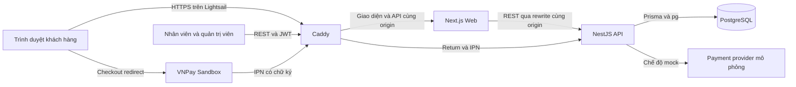
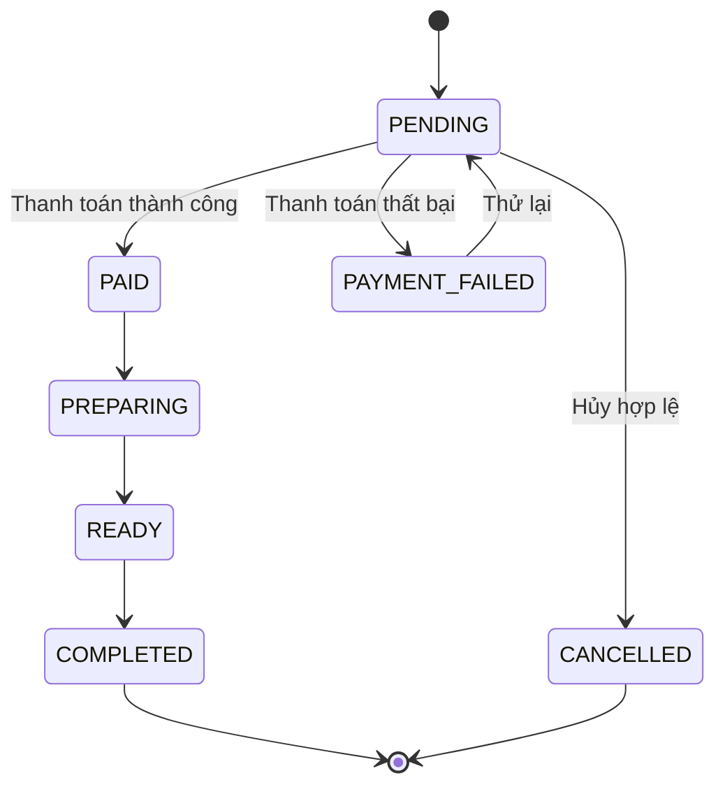

# Kiến trúc BrewLite

BrewLite là ứng dụng đặt trước đồ uống, thanh toán không dùng tiền mặt và nhận tại quầy. Khách hàng đặt món trên web. Nhân viên và quản trị viên thao tác qua REST API. Mô tả dưới đây dựa trên các điểm khởi chạy, mã nghiệp vụ, schema, migration, cấu hình và kiểm thử hiện có trong repository.

## 1. Bối cảnh và các thành phần

- **Khách hàng** duyệt thực đơn, chọn size và topping, đăng ký hoặc đăng nhập, đặt món, thanh toán và xem lịch sử đơn. Khách có thể hủy đơn đủ điều kiện hoặc thanh toán lại từ trang chi tiết.
- **Nhân viên (`STAFF`)** và **quản trị viên (`ADMIN`)** cập nhật tiến độ pha chế qua REST API. `ADMIN` có thêm quyền quản lý nguyên liệu, biến động kho và công thức. Tài khoản đăng ký qua web có vai trò `CUSTOMER`.
- **VNPay Sandbox** nhận người dùng từ trang checkout, gửi thông báo kết quả (IPN) trực tiếp đến API và đưa trình duyệt về Return URL.



Repository sử dụng **npm workspaces** (`apps/*`) và một `package-lock.json` chung. Web và API có vòng đời build, tiến trình và Docker image riêng. API là một ứng dụng NestJS, dùng chung PostgreSQL cho các nghiệp vụ cần cập nhật nguyên tử.

Tài liệu Task 3.1 kết hợp sơ đồ ranh giới hệ thống với kiến trúc phân lớp ở API. Monorepo cho phép cập nhật đồng thời web, hợp đồng API và test trong một PR, đổi lại pipeline và lockfile dùng chung cần được review khi nâng dependency. NestJS chạy một tiến trình nghiệp vụ để đơn, kho và thanh toán dùng chung transaction PostgreSQL, nên các miền cùng chia sẻ vòng đời triển khai API. Provider mock giúp tái chạy kiểm thử, còn VNPay Sandbox thêm phụ thuộc callback và trạng thái chờ. Xem [quyết định kiến trúc](adr/README.md).

| Vị trí | Trách nhiệm |
| --- | --- |
| [`apps/web`](../../apps/web) | Next.js 16 App Router, React 19, TypeScript, CSS toàn cục và Tailwind CSS 4. Giao diện tiếng Việt, ưu tiên màn hình di động. |
| [`apps/api`](../../apps/api) | NestJS 12 trên Express, TypeScript, REST API, xác thực, xử lý nghiệp vụ và Prisma 7 với adapter `@prisma/adapter-pg`. |
| [`apps/api/prisma`](../../apps/api/prisma) | Mô hình Prisma, các migration SQL đang dùng và thư mục migration lịch sử. |
| [`apps/api/scripts`](../../apps/api/scripts) | Chuẩn bị schema, gieo dữ liệu mẫu, cấp vai trò và chạy smoke test nghiệp vụ. |
| [`apps/api/test`](../../apps/api/test) | Kiểm thử HTTP qua Supertest, kiểm thử tích hợp PostgreSQL và dữ liệu fixture. |
| [`docker-compose.yml`](../../docker-compose.yml), [`.github/workflows/ci.yml`](../../.github/workflows/ci.yml) | Cấu hình chạy ba dịch vụ cục bộ và pipeline kiểm tra chất lượng. |

## 2. Frontend

[`layout.tsx`](../../apps/web/src/app/layout.tsx) thiết lập metadata, bố cục chung và `StoreProvider`. [`components/ui.tsx`](../../apps/web/src/components/ui.tsx) chứa các thành phần dùng chung cho điều hướng, thẻ sản phẩm, chọn số lượng và hiển thị trạng thái. Ảnh tĩnh nằm trong `apps/web/public`. [`manifest.ts`](../../apps/web/src/app/manifest.ts) khai báo chế độ hiển thị `standalone` và biểu tượng PWA.

| Route | Hành vi |
| --- | --- |
| `/`, `/menu` | Đọc thực đơn từ API, tìm kiếm theo tên hoặc danh mục và lọc danh mục trên trình duyệt. |
| `/product/[id]`, `/cart` | Chọn size, topping, số lượng, chỉnh giỏ và tính tổng tạm tính. |
| `/register`, `/login`, `/account` | Quản lý phiên đăng nhập và hiển thị hồ sơ từ phiên đã lưu. |
| `/checkout` | Yêu cầu đăng nhập, tạo đơn, rồi gọi API thanh toán. |
| `/orders`, `/orders/[id]` | Xem đơn của tài khoản, lịch sử trạng thái và giao dịch, làm mới, hủy hoặc thanh toán lại khi phù hợp. |
| `/success/[id]` | Đọc trạng thái đơn từ API. Khi đơn còn `PENDING`, hỏi lại khoảng mỗi 2 giây trong tối đa 30 giây và cho phép làm mới thủ công. Xóa giỏ khi đơn đã thanh toán. |

[`store.tsx`](../../apps/web/src/lib/store.tsx) dùng React Context để quản lý giỏ và phiên. `localStorage` lưu `brewlite-cart` và `brewlite-session`, gồm cả access token. Số lượng và giá trong giỏ phục vụ hiển thị. API là nơi xác định giá và khả năng đáp ứng đơn.

[`api.ts`](../../apps/web/src/lib/api.ts) gọi `fetch` với `cache: 'no-store'`, gắn Bearer token khi cần và chuyển lỗi HTTP thành thông báo cho UI. Request đi đến `/api/backend/...` trên cùng origin. [`next.config.ts`](../../apps/web/next.config.ts) rewrite đường dẫn này sang NestJS theo `API_INTERNAL_URL`. Cách này cho phép trình duyệt dùng một origin và web dùng địa chỉ API nội bộ trong Compose. Cấu hình `NEXT_PUBLIC_PAYMENT_MODE` quyết định UI hiển thị mock hay VNPay.

## 3. Backend và hợp đồng HTTP

[`main.ts`](../../apps/api/src/main.ts) nạp cấu hình local, khởi tạo NestJS trên Express và gọi [`configureHttp`](../../apps/api/src/http.ts). [`AppModule`](../../apps/api/src/app.module.ts) nạp `JwtModule` và `PrismaModule`, đồng thời đăng ký trực tiếp controller, service và guard, gồm cả coupon và kho. Controller nhận HTTP, DTO và pipe kiểm tra dữ liệu, service điều phối nghiệp vụ và PrismaService quản lý kết nối PostgreSQL. Xem [PrismaService và vòng đời kết nối](../../apps/api/src/prisma/prisma.service.ts).

| Nhóm | Endpoint thực tế | Quyền |
| --- | --- | --- |
| Vận hành | `GET /`, `GET /health` | Công khai. Health chạy `SELECT 1` và trả HTTP `503` khi DB không sẵn sàng. |
| Xác thực | `POST /auth/register`, `POST /auth/login` | Công khai. Trả access token và hồ sơ rút gọn. |
| Thực đơn | `GET /products`, `GET /products/:id` | Công khai. Sản phẩm đang bán, chi tiết gồm size và topping. |
| Khuyến mãi | `GET /coupons`, `GET /coupons/validate?code=…&amount=…` | Công khai. Tính ưu đãi theo số tiền gửi vào. |
| Đơn của người dùng | `POST /orders`, `GET /orders/me`, `GET /orders/:id`, `PATCH /orders/:id/cancel` | JWT cho cả ba vai trò. Tạo đơn cho tài khoản trong token. Đọc và hủy theo chủ sở hữu. `:id` là UUID của đơn. |
| Pha chế | `PATCH /orders/:id/status` | `STAFF` hoặc `ADMIN`. Nhận `PREPARING`, `READY` hoặc `COMPLETED` theo trạng thái hiện tại. |
| Thanh toán | `POST /payments` | JWT, chủ đơn và header `Idempotency-Key` dạng UUID v4. |
| Callback VNPay | `GET /payments/vnpay/return`, `GET /payments/vnpay/ipn` | Xác minh dữ liệu callback bằng chữ ký VNPay. |
| Kho nguyên liệu | `GET /inventory/ingredients`, `POST /inventory/ingredients`, `PATCH /inventory/ingredients/:id`, `POST /inventory/ingredients/:id/movements` | `ADMIN`. ID nguyên liệu là số nguyên. |
| Công thức | `GET /inventory/products/:productId/recipes`, `PUT /inventory/products/:productId/recipes/:size`, `GET /inventory/toppings/recipes`, `PUT /inventory/toppings/:toppingId/recipe` | `ADMIN`. `PUT` thay tập nguyên liệu của size hoặc topping. |

[`auth.ts`](../../apps/api/src/auth.ts) chuẩn hóa email, băm mật khẩu bằng bcrypt và ký JWT HS256 có thời hạn, issuer và audience. `JwtGuard` kiểm tra token rồi đọc người dùng và vai trò từ DB trên mỗi request được bảo vệ. Đăng xuất trên web xóa phiên ở trình duyệt. Token đã cấp có hiệu lực đến khi hết hạn nếu tài khoản còn tồn tại.

[`http.ts`](../../apps/api/src/http.ts) giới hạn body ở 64 KB và kiểm tra cấu trúc body. [`validation.ts`](../../apps/api/src/validation.ts) cấu hình pipe toàn cục để chuyển đổi DTO và từ chối trường ngoài hợp đồng. [`api-error.filter.ts`](../../apps/api/src/api-error.filter.ts) chuẩn hóa lỗi thành JSON có `statusCode`, `code`, `message`, `details`, `requestId`, `path` và `timestamp`. Lỗi phía máy chủ có `X-Request-Id` để đối chiếu với log. IPN trả HTTP `200` kèm `RspCode` và `Message` theo giao thức VNPay.

## 4. Dữ liệu và tính nhất quán

| Nhóm | Model Prisma | Vai trò |
| --- | --- | --- |
| Tài khoản | `User`, `LoyaltyTransaction` | Hồ sơ, vai trò, số dư điểm và sổ điểm `EARN`, `REDEEM`, `REFUND`. |
| Danh mục | `Product`, `ProductSize`, `Topping`, `ProductTopping` | Giá gốc và tồn theo món, chênh lệch giá theo size, quan hệ nhiều-nhiều giữa món và topping. |
| Đơn hàng | `Order`, `OrderStatusHistory` | Chủ đơn, mã hiển thị `BL-…`, tổng tiền và lịch sử chuyển trạng thái có thứ tự. `Order.items` lưu các dòng hàng dưới dạng JSONB. |
| Thanh toán | `Payment` | Mỗi lần thử lưu phương thức, số tiền, kết quả, khóa idempotency và phản hồi đã ghi. Lần thử VNPay có thêm mã giao dịch và URL checkout. |
| Khuyến mãi | `Coupon` | Mã duy nhất, giảm theo phần trăm hoặc số tiền cố định, mức đơn tối thiểu, giảm tối đa và cờ kích hoạt. |
| Kho | `Ingredient`, `ProductRecipe`, `ToppingRecipe`, `InventoryMovement` | Tồn nguyên liệu dạng decimal, định lượng theo size hoặc topping, nhật ký nhập, điều chỉnh, tiêu hao và hoàn kho. |

Tiền lưu dưới dạng số nguyên VND. Snapshot dòng hàng chốt tên món, size, topping, số lượng và giá khi tạo đơn, giúp lịch sử giữ đúng nội dung ngay cả khi thực đơn thay đổi. `OrderStatusHistory` ghi trạng thái trước, sau và người thực hiện. PostgreSQL bổ sung khóa ngoại, `CHECK`, khóa duy nhất theo `(user_id, idempotency_key)` và chỉ mục duy nhất có điều kiện để mỗi đơn có tối đa một thanh toán `SUCCESS`. Xem [Prisma schema](../../apps/api/prisma/schema.prisma), [migration SQL](../../apps/api/prisma/migrations) và [sơ đồ mô hình dữ liệu](../diagrams/ClassDiagram_BrewLite.puml).

Tồn được quản lý ở hai cấp. `Product.stock` áp dụng cho mọi món. Hệ thống cộng nhu cầu theo từng nguyên liệu từ các công thức đã cấu hình, nhân với số lượng món và ghi biến động. Món chưa có công thức vẫn bán dựa trên tồn theo sản phẩm. Cập nhật tồn dùng điều kiện số dư đủ và thực hiện theo thứ tự định danh. Các luồng thanh toán, hủy và đổi trạng thái khóa dòng bằng `SELECT … FOR UPDATE` ở những bước cần đồng bộ. [`OrdersService`](../../apps/api/src/orders.ts) cập nhật trạng thái theo giá trị hiện tại và ghi lịch sử trong cùng transaction.

## 5. Luồng đặt món và thanh toán

1. **Tạo đơn.** Checkout gửi ID món, ID size, danh sách topping và số lượng. API đọc menu, kiểm tra khả dụng, dùng size mặc định khi không chỉ định, rồi tính `đơn giá = giá gốc + chênh lệch size + giá topping`. Trong một transaction, API tính ưu đãi và điểm nếu có, trừ tồn món, lưu đơn `PENDING` và snapshot, ghi lịch sử và trừ nguyên liệu theo công thức. Lỗi ở bất kỳ bước nào làm rollback toàn bộ transaction.
2. **Áp dụng ưu đãi.** API chuẩn hóa mã giảm giá, kiểm tra kích hoạt và mức đơn tối thiểu, rồi áp trần giảm nếu có. Điểm dùng sau coupon theo tỷ lệ `1 điểm = 1.000 VND` và bị giới hạn theo số dư cùng số tiền còn lại. Đơn thanh toán thành công tích `floor(tổng thanh toán / 10.000)` điểm. Đơn hủy đủ điều kiện hoàn lại điểm đã dùng.
3. **Thanh toán mock.** Chế độ mặc định hỗ trợ `EWALLET` và `CARD` với kết quả mô phỏng. Thành công chuyển đơn sang `PAID`, ghi thanh toán và cộng điểm. Thất bại chuyển sang `PAYMENT_FAILED`, hoàn tồn món và hoàn nguyên liệu đã trừ. Điểm đã đổi gắn với đơn trong thời gian chờ thử lại. Checkout giữ giỏ khi thanh toán lỗi.
4. **Thanh toán VNPay.** API tạo bản ghi `PENDING`, sinh `vnp_TxnRef` riêng cho lần thử và trả URL ký HMAC-SHA512, có hạn 15 phút. Sau khi redirect, Return URL kiểm tra chữ ký, mã terminal, mã giao dịch và số tiền để điều hướng trình duyệt về web. IPN hợp lệ mới cập nhật đơn và thanh toán. API dùng số tiền từ DB, quy đổi sang đơn vị VNPay nhân 100 và khóa giao dịch trước khi ghi kết quả. Callback lặp nhận mã đã xác nhận. Trang kết quả lấy trạng thái trực tiếp từ API BrewLite.
5. **Thử lại và hủy.** Khi retry sau `PAYMENT_FAILED`, API xác thực lại lựa chọn, giữ tồn món theo snapshot và tính nhu cầu nguyên liệu theo công thức hiện hành. Hủy hợp lệ từ `PENDING` hoàn tồn, hoàn nguyên liệu và điểm trong một transaction. Một lần thử VNPay còn `PENDING` chặn hủy và API tái sử dụng lần thử đó. Khi URL hết hạn, API bỏ URL khỏi phản hồi và vẫn chờ kết quả IPN.
6. **Pha chế và bàn giao.** Nhân viên chuyển `PAID` → `PREPARING` → `READY` → `COMPLETED`. Chủ đơn đọc tiến độ qua API. Các bước chuyển trái với sơ đồ trả lỗi `409`.



Khóa idempotency áp dụng ở `POST /payments`. API tra khóa theo người dùng để phát lại phản hồi cho cùng yêu cầu, hoặc trả `409` nếu khóa gắn với một đơn, phương thức hay kết quả mô phỏng khác. Ở trang checkout, ID đơn đang thực hiện và khóa thanh toán nằm trong bộ nhớ của màn hình. Tải lại trang sẽ mất phần trạng thái đó. Tạo đơn là một request riêng với thanh toán và hiện chưa có khóa idempotency riêng. Xem [`orders.ts`](../../apps/api/src/orders.ts), [`order-state.ts`](../../apps/api/src/order-state.ts), [`payments.ts`](../../apps/api/src/payments.ts), [`vnpay.ts`](../../apps/api/src/vnpay.ts) và [sơ đồ trình tự checkout](../diagrams/sequence-checkout.puml).

## 6. Khởi chạy và cấu hình

### Triển khai trên Lightsail

Stack `brewlite-server` chạy trên một máy Lightsail tại `ap-southeast-2`. Caddy tiếp nhận HTTPS cho `brewlite.vkhair.dev`, chuyển request web đến Next.js và chuyển trực tiếp Return/IPN của VNPay đến NestJS. Next.js gọi API qua rewrite và API kết nối PostgreSQL 16 trong mạng nội bộ Compose. Xem [triển khai và kiểm tra trạng thái](../deployment.md), [sơ đồ Lightsail](../diagrams/deploymentDiagram.puml) và [ADR-0005](adr/0005-aws-lightsail.md).

### Phát triển cục bộ

CI và Dockerfile dùng Node.js 24. Với checkout mới, tạo `.env` từ [`.env.example`](../../.env.example) nếu chưa có. Build API trước khi chạy `db:setup`, vì script seed import Prisma Client đã biên dịch từ `apps/api/dist`.

```bash
npm ci
docker compose up -d postgres
npm run build:api
npm run db:setup
```

Chạy `npm run dev:api` và `npm run dev:web` ở hai terminal. Cổng host mặc định là web `3002`, API `3003` và PostgreSQL `5433`. `GET http://localhost:3003/health` kiểm tra API và DB. Có thể cấp quyền cho tài khoản đã đăng ký qua `npm run user:staff -- email@example.com` hoặc `npm run user:admin --workspace=api -- email@example.com` sau khi build API.

[`db:setup`](../../apps/api/package.json) chạy `migrate.cjs` rồi `seed.cjs`. Với DB UUID cũ phù hợp, script ghi nhận baseline Prisma trước khi chạy `prisma migrate deploy`. DB mới được áp migration baseline và migration mở rộng. Seed thêm dữ liệu mẫu theo ID hoặc mã ổn định và giữ các giá trị đã có. `apps/api/db`, `apps/api/prisma/migrations-legacy` và `apps/api/legacy-prisma-v1` chứa schema hoặc mã lịch sử. Đường dẫn migration hiện hành được khai báo trong [`prisma.config.ts`](../../apps/api/prisma.config.ts).

### Docker và biến môi trường

- Compose định nghĩa PostgreSQL 16, API và web. Healthcheck của PostgreSQL mở đường cho API. Container API chạy migration và seed trước khi start. Web chờ API healthy và proxy sang `http://api:3001`. PostgreSQL lưu dữ liệu trong volume `postgres_data`. Cổng publish mặc định chỉ gắn vào loopback của host.
- `DATABASE_URL` là kết nối API và Prisma CLI. `JWT_SECRET` cần ít nhất 32 byte và `JWT_EXPIRES_IN` mặc định là `1d`. `WEB_PORT`, `API_PORT`, `POSTGRES_PORT` và `API_INTERNAL_URL` cấu hình địa chỉ phía ứng dụng.
- `PAYMENT_MODE` chọn `mock` hoặc `vnpay` ở API. Khi chạy web trực tiếp ngoài Docker với VNPay, đặt thêm `NEXT_PUBLIC_PAYMENT_MODE=vnpay` trước khi start dev hoặc build. Compose truyền biến này vào build web từ `PAYMENT_MODE`. API ở `NODE_ENV=production` chỉ cho phép mock khi `ALLOW_MOCK_PAYMENTS=true`.
- VNPay cần `VNPAY_TMN_CODE`, `VNPAY_HASH_SECRET` và `VNPAY_RETURN_URL`. `VNPAY_PAYMENT_URL` phải trỏ cổng Sandbox. `VNPAY_FRONTEND_URL` là đích redirect về web. Địa chỉ IPN phải được đăng ký với VNPay và truy cập từ bên ngoài. `VNPAY_IPN_URL` trong cấu hình mẫu ghi lại địa chỉ đó, việc đăng ký diễn ra ngoài ứng dụng.
- Một điểm cần xử lý khi build sạch image API là `prisma generate` nạp `prisma.config.ts`, trong đó `env('DATABASE_URL')` yêu cầu biến ngay lúc build. Compose cấp biến ở runtime, còn Dockerfile hiện chưa cấp cho builder. Workflow CI dùng URL placeholder cho bước generate. Phát hiện này dựa trên cấu hình trong repo, chưa được kiểm chứng bằng một lần build image sạch.

## 7. Kiểm thử và giới hạn hiện tại

| Kiểm tra | Phạm vi |
| --- | --- |
| `npm run lint` | Oxlint cho API và ESLint cho web. |
| `npm test` | Jest unit cho API, gồm health và tổng hợp định lượng. Script test web hiện chỉ in thông báo và thoát thành công. |
| `npm run test:e2e --workspace=api` | Supertest kiểm tra route gốc qua NestJS với `PrismaService` thay thế bằng mock. |
| `npm run test:integration` | Chạy trên bản build API với PostgreSQL thật qua `TEST_DATABASE_URL` hoặc `DATABASE_URL` từ môi trường hay `.env` gốc. Suite tạo schema riêng, áp migration và fixture, kiểm tra API, giao dịch, tồn, coupon, điểm và VNPay mô phỏng, rồi xóa schema kiểm thử. |
| `npm run build` | Generate Prisma Client và build NestJS, sau đó build Next.js. |

[GitHub Actions](../../.github/workflows/ci.yml) kích hoạt khi push hoặc mở pull request vào `main`, chạy `npm ci` → generate Prisma Client → lint → test → build. Integration và e2e có lệnh riêng ngoài pipeline này.

- Web tập trung vào hành trình khách hàng. Coupon, đổi điểm, cập nhật tiến độ pha chế và kho đã có nghiệp vụ ở backend, trong khi checkout web hiện chỉ gửi dòng hàng và web chưa có màn hình vận hành tương ứng.
- Web có manifest PWA, còn repository chưa có service worker hoặc luồng đặt hàng offline. Tiến độ đơn đi qua REST và cơ chế hỏi lại ở trang kết quả. Tích hợp VNPay hiện chạy với Sandbox. Chưa có tác vụ nền đối soát hoặc đóng giao dịch VNPay `PENDING` đã hết hạn.
- Retry với món có công thức cần kiểm thử thêm. Khi retry, `consume()` ghi `CONSUMPTION` mới cho cùng đơn, trong khi bảng `inventory_movements` chỉ cho phép một bản ghi mỗi `(order_id, ingredient_id, type)`. Với nguyên liệu đã có biến động ở lần trước, thao tác có thể gặp ràng buộc duy nhất và rollback. Xem [dịch vụ kho](../../apps/api/src/inventory/inventory.service.ts) và [migration mở rộng](../../apps/api/prisma/migrations/20261115001000_api_features/migration.sql).
- Với thanh toán mock, API lưu `SUCCESS` khi request bỏ qua `mockOutcome`. Khi phát lại cùng request, phép so sánh dùng `null` cho trường vắng mặt, vì vậy client có thể nhận `409` dù gửi lại cùng nội dung. Checkout web luôn gửi `mockOutcome` trong chế độ mock. Xem [dịch vụ thanh toán](../../apps/api/src/payments.ts) và [trang checkout](../../apps/web/src/app/checkout/page.tsx).

Xem thêm [đặc tả yêu cầu](../requirements/srs.md), [ma trận truy vết](../traceability-matrix.md) và [danh mục ADR](adr/README.md).
